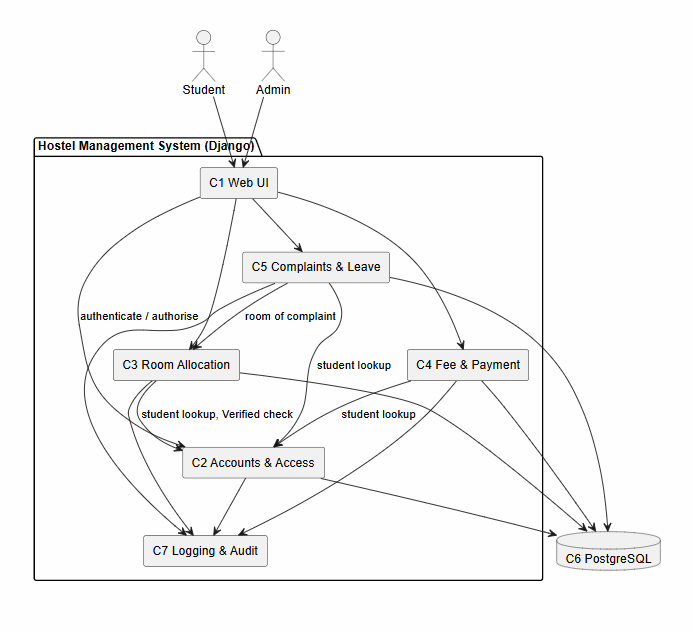
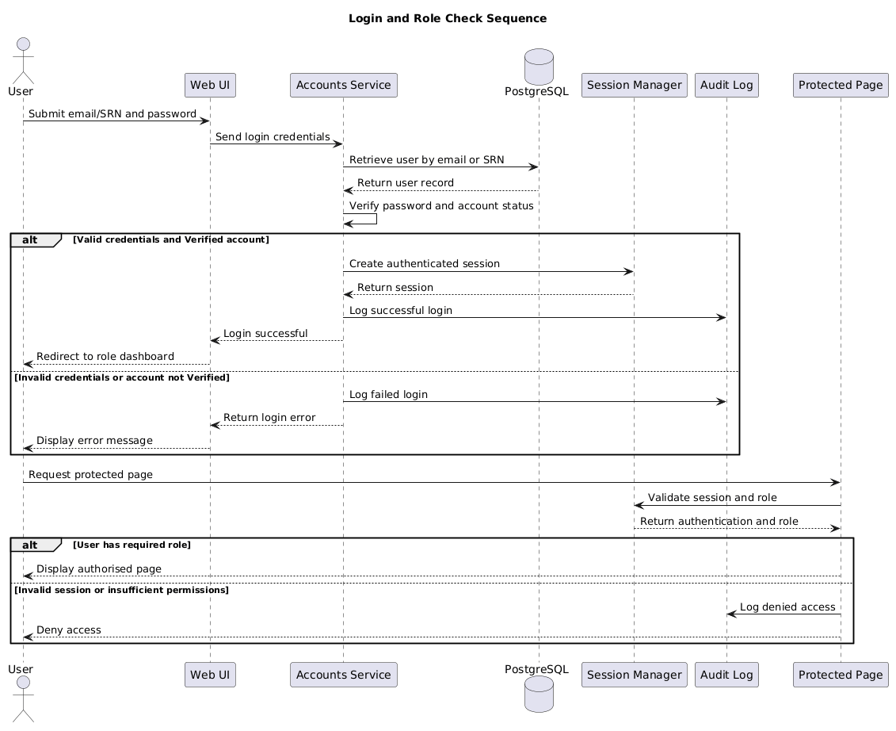
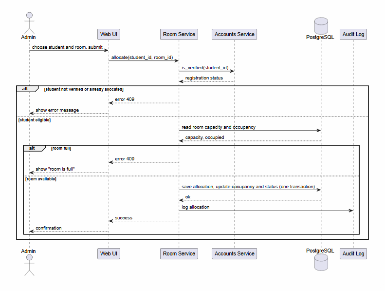

# Software Architecture and Design Specification

- **Project:** Hostel Management System (HMS)
- **Version:** 1.0
- **Authors:** Group G-03 - Tejasvi K S (PES1UG24CS499), Prathiksha B P (PES1UG24CS925), Vilohith (PES1UG24CS535), Varsha (PES1UG24CS516)
- **Date:** 12-10-2026
- **Status:** Draft for review

# Revision History

| Version | Date | Author | Change Summary |
|---|---|---|---|
| 0.1 | 11-10-2026 | Team | Initial draft of architecture and design |
| 1.0 | 12-10-2026 | Team | Reviewed and submitted for Jackfruit Part 1 |

# Approvals

| Role | Name | Signature/Date |
|---|---|---|
| Team Lead | | |
| Faculty | | |

# 1. Introduction

## 1.1 Purpose

This document specifies the architecture and design of the Hostel Management System (HMS), a web application that manages hostel room allocation, student details, fee payment records, complaints and leave requests.

## 1.2 Scope

Covers four functional modules: Accounts & Access, Room Allocation, Fee & Payment, and Complaints & Leave. Mobile apps, online payment gateways and visitor management are out of scope (SRS 1.3).

## 1.3 Audience

Developers, QA engineers, security reviewers, faculty evaluators and future maintainers.

## 1.4 Definitions

HMS (Hostel Management System), SRS (Software Requirements Specification), STP (Software Test Plan), RBAC (Role-Based Access Control), MVT (Model-View-Template, Django's architecture style), ORM (Object-Relational Mapper), CSRF (Cross-Site Request Forgery), STRIDE (Spoofing, Tampering, Repudiation, Information disclosure, Denial of service, Elevation of privilege), UML (Unified Modeling Language), NFR (Non-Functional Requirement).

# 2. Document Overview

## 2.1 How to use this document

Section 3 describes the architecture: components, pattern, technology and security. Section 4 describes the design: sequence diagrams, APIs, error handling and UX.

## 2.2 Related Documents

SRS v1.3 (requirements and traceability matrix), STP v1.0 (test plan and test cases).

# 3. Architecture

<!-- SAD-P3-1 -->

## 3.2 Stakeholders & Concerns

| Stakeholder | Concerns |
|---|---|
| Student | Easy view of room and fees, privacy of personal data, quick complaint and leave handling |
| Admin | Control over students, rooms, fees and requests; accurate records; dues report |
| Developers / maintainers | Modularity, readable code, testability |
| Faculty / evaluators | Traceability, security, evidence of process |

## 3.3 Component (UML) Diagram

*Figure 1: HMS component diagram. Arrows show the direction of dependency.*

## 3.4 Component Descriptions

- **C1 Web UI (Templates):** server-rendered Django pages for Student and Admin; collects input and shows results.
- **C2 Accounts & Access:** registration with admin verification, login, sessions, roles and student profiles; used by every other component for authentication and authorisation.
- **C3 Room Allocation:** blocks, rooms with capacity, allocation, deallocation and occupancy status; asks C2 whether a student is Verified before allocating.
- **C4 Fee & Payment:** fee amount per student, payment records, outstanding balance and the dues report.
- **C5 Complaints & Leave:** complaint filing and status tracking, leave requests and Admin decisions; links records to the student (C2) and room (C3).
- **C6 PostgreSQL database:** stores users, rooms, fees, payments, complaints and leave requests with foreign-key constraints.
- **C7 Logging & Audit:** records failed logins, denied access and key business actions (allocation, payment, decisions) as required by SEC-6.

## 3.5 Chosen Architecture Pattern and Rationale

HMS uses a **layered modular monolith** built on Django's Model-View-Template style. Layers: Presentation (templates) -> Views (request handling and validation) -> Services (business rules) -> Models/ORM -> PostgreSQL. Each functional module is one Django app with its own models, views, services and tests, so team members work in separate folders and modules call each other only through service functions.

**Rejected alternatives:** microservices, because they add deployment and network complexity and make transactions such as allocation with an occupancy update harder, which is not justified for a four-person team and a single relational database; a flat single-app monolith, because it gives poor separation of concerns and constant merge conflicts.
<!-- SAD-P3-2 -->
<!-- SAD-P4-1 -->

## 3.9 Security Architecture

**Security objectives (SRS 6.3.1):** SO-1 confidentiality of student, fee, complaint and leave data; SO-2 integrity of allocation and payment records; SO-3 accountability for privileged actions.

**Threat modelling (STRIDE)**

| Threat | Example in HMS | Mitigation |
|---|---|---|
| Spoofing | Someone logs in as another student | Django authentication, hashed passwords (SEC-1), server-side sessions |
| Tampering | Student edits another student's fee record or alters form fields | CSRF tokens (SEC-5), ORM parameterised queries, server-side validation and ownership checks (SEC-3) |
| Repudiation | Admin denies approving a leave request or allocation | Audit log with user and timestamp (SEC-6) |
| Information disclosure | Student views another student's profile or dues | Role-based views and object-level checks (SEC-2), HTTPS/TLS, no personal data or passwords in logs |
| Denial of service | Heavy report queries | Pagination, request timeouts, database indexes |
| Elevation of privilege | Student opens an admin URL | Role checked on the server in every view (RBAC, SEC-2), least-privilege database user |

- **Authentication:** every user logs in with email (or SRN for students) and a password. Passwords are never stored in plaintext (SEC-1). Accounts that are not Verified cannot log in (REQ-2, REQ-21).
- **Authorisation:** two roles (Student, Admin). Each view declares the roles allowed; any other role gets 403 (SEC-2).
- **Session management:** server-side sessions with an expiry time. Expired or invalid sessions are rejected and the user is sent to the login page (SEC-4).
- **Data protection:** the database is reachable only from the application container, and secrets are kept in environment variables, not in the repository.

# 4. Design

<!-- SAD-P4-2 -->

## 4.2 UML Sequence Diagrams

### 4.2.1 Login and Role Check

The sequence diagram below illustrates authentication, account verification, session creation, role checking, and audit logging.

### 4.2.2 Allocate a room (Room Allocation)
Shows the Admin allocating a room (REQ-7, REQ-8, REQ-10). The service rejects a student who is not Verified or already has a room, and a room that is full. The allocation and the occupancy change are saved in one database transaction (NFR-3) and the action is written to the audit log (SEC-6).

<!-- SAD-P3-3 -->
<!-- SAD-P4-3 -->

## 4.3 API Design

Interfaces below are Django URL routes that receive HTML form submissions (GET and POST). Request and response fields describe the form inputs and the page results. There is no separate REST API (SRS 3.3).

### 4.3.1 Accounts & Access API

**POST /accounts/register/** (REQ-1, REQ-2)
- Auth: none
- Request: {name, email, srn, guardian_contact, password}
- Response: {status, user_id} (account created as Pending)
- Errors: 400 missing or invalid field, 409 email or SRN already registered

**POST /accounts/login/** (REQ-21)
- Auth: none
- Request: {identifier (email or SRN), password}
- Response: {status, role, redirect}
- Errors: 401 invalid credentials or account not Verified

**POST /accounts/registrations/{id}/decision/** (REQ-3)
- Auth: Admin
- Request: {decision (Verified or Rejected)}
- Response: {user_id, registration_status}
- Errors: 400 invalid decision, 403 role not permitted, 404 registration not found

### 4.3.2 Room Allocation API

**GET /rooms/available/**
- Auth: logged-in user (Student or Admin)
- Request: query parameters block, room_type
- Response: list of {room_id, block, room_type, capacity, occupied}
- Errors: 400 invalid filter, 401 not logged in

**POST /rooms/allocate/** (REQ-7, REQ-8, REQ-10)
- Auth: Admin
- Request: {student_id, room_id}
- Response: {status, room_id, occupied}
- Errors: 400 invalid input, 403 role not permitted, 404 student or room not found, 409 room full, student not Verified, or student already allocated

**POST /rooms/deallocate/** (REQ-9, REQ-10)
- Auth: Admin
- Request: {student_id}
- Response: {status, room_id, occupied}
- Errors: 400 invalid input, 403 role not permitted, 404 student not found or has no room
<!-- SAD-P3-4 -->
<!-- SAD-P4-4 -->

<!-- SAD-P3-5 -->

<!-- SAD-P4-5 -->
