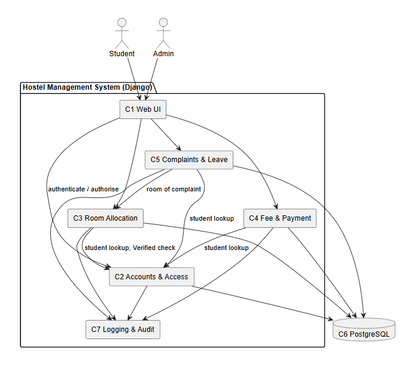
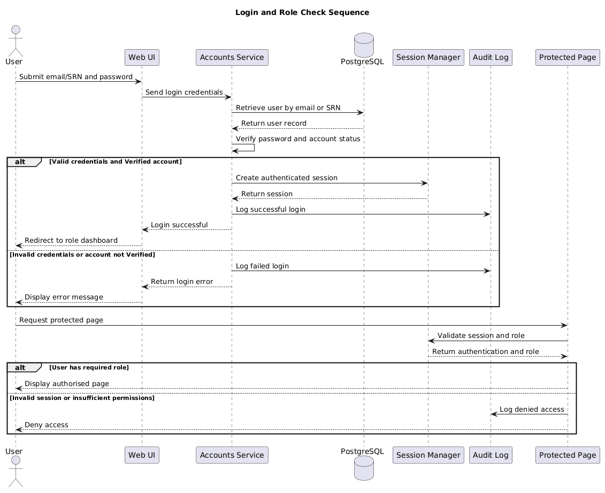
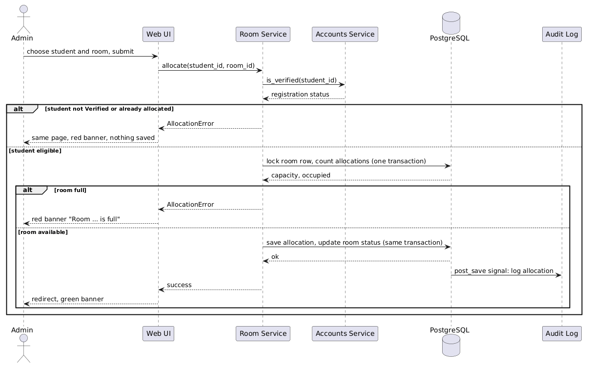
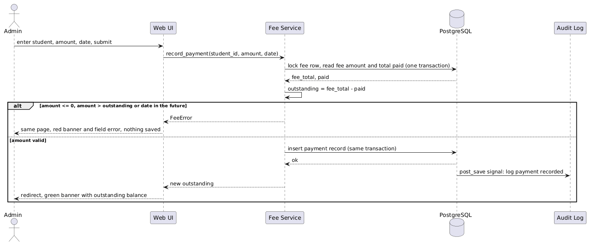
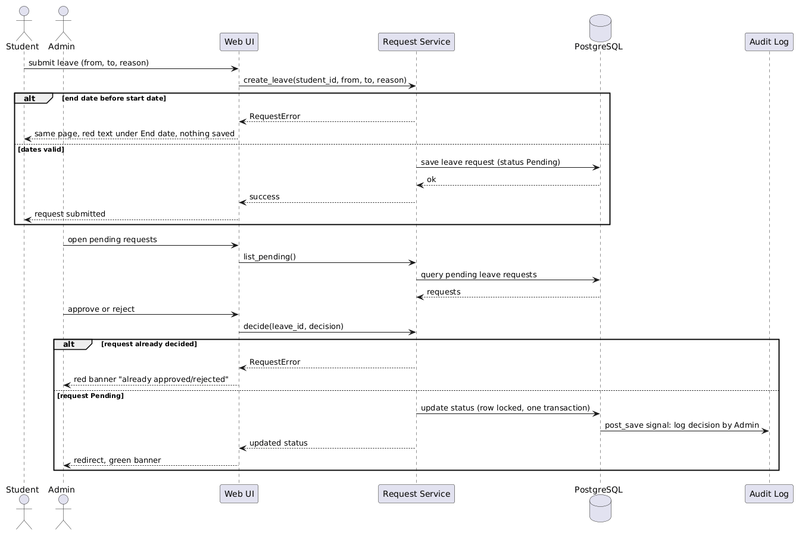

# Software Architecture and Design Specification

- **Project:** Hostel Management System (HMS)
- **Version:** 2.0 (Final)
- **Authors:** Group G-03 - Tejasvi K S (PES1UG24CS499), Prathiksha B P (PES1UG24CS925), Vilohith (PES1UG24CS535), Varsha (PES1UG24CS516)
- **Date:** 08-11-2026
- **Status:** Final, matches the implemented system at the end of Sprint 2

# Revision History

| Version | Date | Author | Change Summary |
|---|---|---|---|
| 0.1 | 11-10-2026 | Team | Initial draft of architecture and design |
| 1.0 | 12-10-2026 | Team | Reviewed and submitted for Jackfruit Part 1 |
| 2.0 | 08-11-2026 | Team | Final version after Sprint 2: technology stack, data stores, API routes, error handling and security architecture updated to match the implementation; Allocation and AuditEntry added; deviations from v1.0 recorded in section 4.7 |

# Approvals

| Role | Name | Signature/Date |
|---|---|---|
| Team Lead | Tejasvi K S | |
| Faculty | | |

# 1. Introduction

## 1.1 Purpose

This document specifies the architecture and design of the Hostel Management System (HMS), a web application that manages hostel room allocation, student details, fee payment records, complaints and leave requests.

## 1.2 Scope

Covers four functional modules: Accounts & Access, Room Allocation, Fee & Payment, and Complaints & Leave, plus two supporting modules: Audit (SEC-6) and Security (session settings, SEC-4). Mobile apps, online payment gateways and visitor management are out of scope (SRS 1.3).

## 1.3 Audience

Developers, QA engineers, security reviewers, faculty evaluators and future maintainers.

## 1.4 Definitions

HMS (Hostel Management System), SRS (Software Requirements Specification), STP (Software Test Plan), RBAC (Role-Based Access Control), MVT (Model-View-Template, Django's architecture style), ORM (Object-Relational Mapper), CSRF (Cross-Site Request Forgery), STRIDE (Spoofing, Tampering, Repudiation, Information disclosure, Denial of service, Elevation of privilege), UML (Unified Modeling Language), NFR (Non-Functional Requirement), CI (Continuous Integration).

# 2. Document Overview

## 2.1 How to use this document

Section 3 describes the architecture: components, pattern, technology and security. Section 4 describes the design: sequence diagrams, URL routes (API), error handling and UX. Section 4.7 lists every deviation from version 1.0 of this document.

## 2.2 Related Documents

SRS v2.0 (requirements and traceability matrix), STP v2.0 (test plan, test cases and test summary report).

# 3. Architecture

## 3.1 Goals & Constraints

**Goals**
- Security: protect student personal and fee data
- Correctness: no double allocation and no mismatch between fees, payments and outstanding balance
- Maintainability: one Django app per module, business rules in service functions
- Usability: common tasks completed in a few screens (NFR-2)
- Responsiveness: meet the response-time requirement (NFR-1)

**Constraints**
- Python with Django and PostgreSQL, as committed in the SRS
- Server-rendered web pages, no separate mobile app or REST API
- Four-person team and a fixed academic deadline
- Open-source tooling: Git/GitHub, GitHub Actions (CI), Docker, SonarQube Cloud, pytest
- All code, including LLM-assisted code, must be understood and explainable by its author

## 3.2 Stakeholders & Concerns

| Stakeholder | Concerns |
|---|---|
| Student | Easy view of room and fees, privacy of personal data, quick complaint and leave handling |
| Admin | Control over students, rooms, fees and requests; accurate records; dues report; audit trail |
| Developers / maintainers | Modularity, readable code, testability |
| Faculty / evaluators | Traceability, security, evidence of process |

## 3.3 Component (UML) Diagram

*Figure 1: HMS component diagram. Arrows show the direction of dependency.*

## 3.4 Component Descriptions

| Component | Django app / folder | Responsibility |
|---|---|---|
| C1 Web UI | `templates/`, `static/`, each app's `templates/` | Server-rendered pages for Student and Admin; role-based menu; shared form and card templates |
| C2 Accounts & Access | `accounts`, `security` | Registration with admin verification, login with email or SRN, roles, student profile, access-control decorators; `security` adds the session settings (SEC-4) |
| C3 Room Allocation | `rooms` | Blocks, rooms with capacity, allocation, deallocation and automatic status; checks that a student is Verified before allocating |
| C4 Fee & Payment | `fees` | Fee per student, payment records, outstanding balance, student Fee Details, admin Dues Report |
| C5 Complaints & Leave | `complaints` | Complaint filing and status updates, leave requests and admin decisions |
| C6 PostgreSQL database | PostgreSQL 16 container | Stores all records with foreign-key and uniqueness constraints |
| C7 Logging & Audit | `audit` | Records logins, failed logins, logouts, denied access and admin changes (SEC-6); Audit Log page for admins |

## 3.5 Chosen Architecture Pattern and Rationale

HMS uses a **layered modular monolith** built on Django's Model-View-Template style. Layers: Presentation (templates) -> Views (request handling, forms and validation) -> Services (business rules) -> Models/ORM -> PostgreSQL. Each functional module is one Django app with its own models, services, views, URLs, templates and tests, so team members work in separate folders and modules call each other only through service functions.

**Module hooks.** `hms/settings.py` lists the modules in `HMS_MODULES` and enables each one only if its folder exists. A module's URLs are included automatically under `/<module>/`, and a module can add settings or middleware through its own `hms_settings.py`. This let the four members merge their modules in any order without editing shared files.

**Audit through signals.** The Audit module listens to Django signals (login, logout, failed login, model saves and deletes) and uses a middleware to know the current user and IP address. The other modules never call the Audit module, so they stay independent of it.

**Rejected alternatives:** microservices, because they add deployment and network complexity and make transactions such as allocation with an occupancy update harder, which is not justified for a four-person team and a single relational database; a flat single-app monolith, because it gives poor separation of concerns and constant merge conflicts.

## 3.6 Technology Stack & Data Stores

| Area | Technology |
|---|---|
| Language | Python 3.12 |
| Framework | Django 5.2 (Model-View-Template) |
| Database | PostgreSQL 16 (Docker and CI); SQLite for local development runs without Docker |
| Front end | Django templates, HTML, CSS |
| Testing | pytest, pytest-django, Django test client, coverage.py; Locust for load testing |
| CI | GitHub Actions: system check, migration check, tests on PostgreSQL, per-module coverage of at least 70% |
| Static analysis | SonarQube Cloud, run by a GitHub Actions workflow with the coverage report |
| Containers | Docker and Docker Compose (application and PostgreSQL) |
| Dependencies | `requirements.txt` (version ranges) and `requirements.lock` (exact versions with SHA-256 hashes, used by CI and Docker) |
| Version control and planning | Git, GitHub, GitHub Projects (backlog, story points, sprints) |

**Main data stores (PostgreSQL tables):** User with role and registration status (C2); Block, Room and Allocation (C3); Fee and PaymentRecord (C4); Complaint and LeaveRequest (C5); AuditEntry (C7). Field layouts are in SRS Appendix B.

**Why PostgreSQL:** ACID transactions for allocation and payment updates, foreign keys and constraints for data integrity, row-level locking (`select_for_update`) for concurrent allocation and payment requests, and first-class Django support.

## 3.7 Risks & Mitigations

| Risk | Mitigation |
|---|---|
| Double allocation of a room under concurrent requests | The room row is locked with `select_for_update` inside a transaction while capacity is checked and the allocation is saved |
| Merge conflicts in shared files | Module hooks (3.5), every file has one owner, small pull requests, CI on every PR |
| Missed role check exposes an admin page | `@admin_required` / `@student_required` on every view, plus an authorization test that opens every page with every role |
| Fees, payments and outstanding balance become inconsistent | The balance is never stored; it is computed from fee and payments, and payment and fee changes lock the fee row |
| Sensitive data leaks into logs | Audit entries store only an identifier and a short description; failed logins never store the password |
| Schedule slip | Two sprints with story points on GitHub Projects, scope fixed to four modules |

## 3.8 Traceability to Requirements

| Requirement | Description | Component | Design reference |
|---|---|---|---|
| REQ-1 | Register with unique email and SRN | C2 Accounts & Access | 3.4, 4.3.1 |
| REQ-2 | New accounts stay Pending until verified | C2 | 3.4, 4.3.1 |
| REQ-3 | Admin approves or rejects a registration | C2 | 3.4, 4.3.1 |
| REQ-4 | Role-based access | C2 (all views) | 3.9, 4.2.1 |
| REQ-5 | Student views and edits own profile | C2 | 4.3.1 |
| REQ-6 | Define blocks and rooms with capacity | C3 Room Allocation | 3.4, 4.3.2 |
| REQ-7 | Prevent allocation beyond capacity | C3 | 4.2.2, 4.3.2 |
| REQ-8 | Allocate a room to a Verified student | C3 | 4.2.2, 4.3.2 |
| REQ-9 | Deallocate a student from a room | C3 | 4.3.2 |
| REQ-10 | Automatic occupancy and status update | C3 | 4.2.2 |
| REQ-11 | Admin defines a fee amount for a student | C4 Fee & Payment | 3.4, 4.3.3 |
| REQ-12 | Admin records a payment | C4 | 4.2.3, 4.3.3 |
| REQ-13 | Outstanding balance calculation | C4 | 4.2.3, 4.3.3 |
| REQ-14 | Payment cannot exceed outstanding balance | C4 | 4.2.3, 4.3.3 |
| REQ-15 | Student views own fee details | C4 | 4.3.3 |
| REQ-16 | Admin dues report | C4 | 4.3.3 |
| REQ-17 | Student files a complaint | C5 Complaints & Leave | 3.4, 4.3.4 |
| REQ-18 | Admin updates complaint status | C5 | 4.3.4 |
| REQ-19 | Student submits a leave request | C5 | 4.2.4, 4.3.4 |
| REQ-20 | Admin approves or rejects a leave request | C5 | 4.2.4, 4.3.4 |
| REQ-21 | Login | C2 | 4.2.1, 4.3.1 |
| SEC-1 | Passwords stored hashed | C2 | 3.9 |
| SEC-2 | Role-based access for admin pages | C2 | 3.9 |
| SEC-3 | Input validation and sanitising | All components | 3.9, 4.4 |
| SEC-4 | Session expiry and rejection | C2 (`security`) | 3.9, 4.2.1 |
| SEC-5 | CSRF protection | C1 Web UI | 3.9 |
| SEC-6 | Audit log | C7 Logging & Audit | 3.5, 3.9, 4.3.5, 4.4 |
| NFR-1 | Response time | C1 to C6 | 3.6 |
| NFR-2 | Complaint filed in 4 screens | C1 Web UI | 4.5 |
| NFR-3 | Atomic updates | C3, C4, C5 | 3.7, 4.2.2, 4.2.3 |
| NFR-4 | Modular code and 70% coverage | All components | 3.5, 3.6, 4.1 |
| NFR-5 | Chrome and Firefox compatibility | C1 Web UI | 3.6 |

## 3.9 Security Architecture

**Security objectives (SRS 6.3.1):** SO-1 confidentiality of student, fee, complaint and leave data; SO-2 integrity of allocation and payment records; SO-3 accountability for privileged actions.

**Threat modelling (STRIDE)**

| Threat | Example in HMS | Mitigation |
|---|---|---|
| Spoofing | Someone logs in as another student | Django authentication, salted PBKDF2 password hashes (SEC-1), server-side sessions, new session key after login |
| Tampering | Student edits another student's fee record or alters form fields | CSRF tokens (SEC-5), ORM parameterised queries, server-side form and service validation, profile form exposes only name and guardian contact (SEC-3) |
| Repudiation | Admin denies approving a leave request or allocation | Audit log with user, IP address and timestamp (SEC-6); audit entries are read-only in the Django admin |
| Information disclosure | Student views another student's profile or dues | Student pages use only `request.user` (no id in the URL); admin pages require the Admin role (SEC-2); passwords never logged; HttpOnly session cookie |
| Denial of service | Heavy list pages | Audit Log paginated at 50 entries per page; the load test (NFR-1) shows a 95th percentile of 52 ms at 10 users. Rate limiting is out of scope for this version |
| Elevation of privilege | Student opens an admin URL | Role and Verified status checked on the server in every view (RBAC, SEC-2); every page is covered by an authorization test |

- **Authentication:** every user logs in with email (or SRN for students) and a password. Passwords are stored as salted PBKDF2 hashes, never in plaintext (SEC-1). Accounts that are not Verified cannot log in (REQ-2, REQ-21).
- **Authorisation:** two roles (Student, Admin). Each view is protected by `@admin_required` or `@student_required`: a user with the wrong role or an unverified account gets 403, and a visitor who is not logged in is sent to the login page (SEC-2).
- **Session management (SEC-4):** server-side sessions that expire after 30 minutes without a request and when the browser is closed; every request restarts the timer; the session is deleted on logout; the cookie is HttpOnly and SameSite=Lax. Expired, deleted or tampered sessions are sent to the login page.
- **CSRF (SEC-5):** Django's CSRF middleware is enabled; every POST form includes a token, and a POST without a valid token gets 403.
- **Input handling (SEC-3):** forms validate type, length and format (for example phone numbers of 10 to 15 digits); services re-check the business rules; templates escape all output, so script text is shown as text.
- **Audit (SEC-6):** see 3.5. Every 403 is logged as "access denied".
- **Data protection and supply chain:** the database is reachable only from the application container; secrets (`DJANGO_SECRET_KEY`, database password) come from environment variables; the Docker image copies only the application folders and runs as a non-root user; dependencies are installed from a hash-locked file with binary wheels only.

# 4. Design

## 4.1 Design Overview

HMS is designed as layered modules for separation of concerns and easier maintenance. Each module is a Django app with the same structure: `models.py` (data), `services.py` (business rules), `forms.py` (input validation), `views.py` (request handling), `urls.py`, `templates/` and `tests/`. Views only call services, and modules call each other only through service functions, for example the Room module checks the Accounts data for a Verified student before allocating a room.

**Key classes (see SRS Appendix B for fields):** User (role, registration status, SRN, guardian contact), Block, Room (block, room type, capacity, status), Allocation (student, room), Fee (student, amount), PaymentRecord (student, amount, date), Complaint (student, room, description, status), LeaveRequest (student, dates, reason, status), AuditEntry (user, action, details, IP address, time).

## 4.2 UML Sequence Diagrams

In all diagrams, a rejected request does not return an HTTP error code: the same page is shown again with a red message and nothing is saved (see 4.4). Audit entries are written by the Audit module's signal handlers when the record is saved.

### 4.2.1 Login and Role Check

The sequence diagram below illustrates authentication, account verification, session creation, role checking, and audit logging.

### 4.2.2 Allocate a room (Room Allocation)
Shows the Admin allocating a room (REQ-7, REQ-8, REQ-10). The service rejects a student who is not Verified or already has a room, and a room that is full. The room row is locked, and the allocation and the status change are saved in one database transaction (NFR-3); the allocation is then written to the audit log (SEC-6).

### 4.2.3 Record a payment (Fee & Payment)
Shows the Admin recording a payment (REQ-12, REQ-13, REQ-14). The service calculates the outstanding balance and rejects an amount that is zero, negative or larger than the outstanding balance, and a date in the future. A valid payment is saved in one transaction with the fee row locked, and written to the audit log.

### 4.2.4 Leave request and Admin approval (Complaints & Leave)
Shows a student submitting a leave request (REQ-19) and the Admin approving or rejecting it (REQ-20). A decision is accepted only while the request is still Pending, and is written to the audit log.

## 4.3 API Design

HMS has no separate REST API (SRS 3.3). Its interface is the set of Django URL routes below. GET returns an HTML page; POST receives an HTML form with a CSRF token. After a successful POST the user is redirected (HTTP 302) and a green message is shown; a rejected POST shows the page again with a red message (see 4.4).

**Auth** column: *Anyone* = no login needed; *Student* / *Admin* = Verified user with that role (others get 403; visitors who are not logged in are sent to the login page).

### 4.3.1 Accounts & Access

| Method | Route | Auth | Purpose (requirement) | Main inputs | Errors shown |
|---|---|---|---|---|---|
| GET | `/` | Anyone | Sends the user to the dashboard for their role, or to login | none | none |
| GET, POST | `/register/` | Anyone | Student registration; account created as Pending (REQ-1, REQ-2) | name, email, srn, guardian_contact, password1, password2 | Missing or invalid field, email or SRN already registered |
| GET, POST | `/login/` | Anyone | Login with email or SRN (REQ-21) | username (email or SRN), password | Invalid credentials, account not Verified |
| POST | `/logout/` | Logged in | Ends and deletes the session (SEC-4) | none | none |
| GET | `/dashboard/` | Student | Student dashboard cards (room, fee, complaints, leave) | none | 403 |
| GET, POST | `/profile/` | Student | View and edit own profile (REQ-5) | name, guardian_contact | Name required, invalid phone number |
| GET | `/admin-panel/` | Admin | Admin dashboard and pending registrations | none | 403 |
| POST | `/admin-panel/registrations/<id>/decision/` | Admin | Approve or reject a registration (REQ-3) | decision = Verified or Rejected | Invalid decision, not found, already decided |

### 4.3.2 Room Allocation

| Method | Route | Auth | Purpose (requirement) | Main inputs | Errors shown |
|---|---|---|---|---|---|
| GET, POST | `/rooms/` | Admin | Room list with occupancy and status; add block or room (REQ-6) | action = add_block (name) or add_room (block, room_number, room_type, capacity) | Capacity below 1, duplicate block or room number |
| GET, POST | `/rooms/<id>/edit/` | Admin | Edit a room (REQ-6) | block, room_number, room_type, capacity | 404 unknown room; capacity below current occupancy |
| GET, POST | `/rooms/allocate/` | Admin | Allocation page; allocate a student to a room (REQ-7, REQ-8, REQ-10) | student, room | Room full, student not Verified, student already has a room |
| POST | `/rooms/allocations/<id>/deallocate/` | Admin | Deallocate a student (REQ-9, REQ-10) | none | Allocation no longer exists; 405 for GET |
| GET | `/rooms/my-room/` | Student | Own room, or "No room allocated yet" | none | 403 |

### 4.3.3 Fee & Payment

| Method | Route | Auth | Purpose (requirement) | Main inputs | Errors shown |
|---|---|---|---|---|---|
| GET, POST | `/fees/` | Admin | Fee overview; set a fee (REQ-11); record a payment (REQ-12, REQ-14) | action = set_fee (fee-student, fee-amount) or record_payment (payment-student, payment-amount, payment-payment_date) | Amount not greater than 0, payment above outstanding, date in the future, no fee defined, fee below amount already paid |
| GET | `/fees/student/<id>/` | Admin | One student's fee, payments and outstanding balance (REQ-13) | none | 404 unknown student |
| GET | `/fees/dues/` | Admin | Dues report with totals, largest balance first (REQ-16) | hide_paid = 1 (optional filter) | 403 |
| GET | `/fees/my/` | Student | Own Fee Details: fee, total paid, outstanding, payment history (REQ-15) | none | 403 |

### 4.3.4 Complaints & Leave

| Method | Route | Auth | Purpose (requirement) | Main inputs | Errors shown |
|---|---|---|---|---|---|
| GET, POST | `/complaints/` | Student | Own complaints and leave requests; file a complaint (REQ-17); submit leave (REQ-19) | action = complaint (description) or leave (start_date, end_date, reason) | No allocated room, empty or too long description, end date before start date, empty reason |
| GET | `/complaints/all/` | Admin | All complaints and leave requests | none | 403 |
| POST | `/complaints/<id>/status/` | Admin | Change complaint status (REQ-18) | status = Open, In-progress or Resolved | Invalid status, same status as now, complaint not found; 405 for GET |
| POST | `/complaints/leave/<id>/decide/` | Admin | Approve or reject a leave request (REQ-20) | decision = Approved or Rejected | Invalid decision, request not found, already decided; 405 for GET |

### 4.3.5 Audit

| Method | Route | Auth | Purpose (requirement) | Main inputs | Errors shown |
|---|---|---|---|---|---|
| GET | `/audit/` | Admin | Audit Log, newest first, 50 per page (SEC-6) | action (optional filter), page | 403 |

## 4.4 Error Handling, Logging & Monitoring

**Error handling:** every view validates input with a Django form, and the service checks the business rules again, so the rules hold wherever a call comes from. Nothing is saved when a check fails.

| Situation | Response | Example in HMS |
|---|---|---|
| Invalid input | Page shown again (HTTP 200) with red text under the field | Capacity 0, phone number "abc", end date before start date |
| Business-rule violation | Page shown again (HTTP 200) with a red banner, and red text under the field at fault | Room full, payment above the outstanding balance, leave already decided |
| Success | Redirect (HTTP 302) to the page with a green banner | "Room A-101 was added successfully." |
| Not logged in or session expired | Redirect (HTTP 302) to the login page | Opening Fee Details after 30 minutes idle |
| Wrong role or account not Verified | 403 page, and an "access denied" audit entry | Student opens `/rooms/` |
| Missing or invalid CSRF token | 403 | POST from a page without a token |
| Unknown id in the URL | 404 | Unknown room on `/rooms/<id>/edit/` |
| Wrong HTTP method | 405 | GET on a POST-only action such as deallocate |
| Unexpected error | Django's generic error page when DEBUG is off; details only in the server log | Database unavailable |

**Logging (SEC-6):** the Audit module records logins, failed logins (with the typed identifier only, never the password), logouts, denied access (every 403), registration decisions, rooms created, allocations, deallocations, fee changes, payments, complaint status changes and leave decisions, each with the user, IP address and time. Session tokens and passwords are never logged.

**Monitoring:** the admin dashboard shows the number of failed logins in the last 24 hours; the Audit Log page shows all events with a filter; every pull request shows the CI test and coverage results and the SonarQube Cloud quality gate.

## 4.5 UX Design

Role-based dashboards for Student and Admin, a left menu that shows only the pages permitted for the role, simple forms with red messages under the field at fault, green and red banners for results, and status badges (Vacant/Occupied, Open/In-progress/Resolved, Pending/Approved/Rejected). Filing a complaint takes 3 screens from the dashboard (4 through the My Room page), within the limit of 4 (NFR-2). Screen prototypes are in SRS section 3.1.

## 4.6 Open Issues & Next Steps

- Email or SMS notifications for approvals and dues
- Online payment gateway integration
- Report export to CSV or PDF
- Login rate limiting or temporary lockout after repeated failed logins
- HTTPS deployment and automated continuous deployment of the Docker image
- Penetration test with OWASP ZAP (planned in STP v1.0, not performed; covered by automated security tests instead)
- Mobile app

## 4.7 Deviations from Version 1.0

The table lists every point where the implemented system differs from version 1.0 of this document (Jackfruit Part 1). All requirements in the SRS are still met.

| # | Version 1.0 | Implemented | Reason |
|---|---|---|---|
| 1 | CI/CD with Jenkins | CI with GitHub Actions; no automated deployment (CD); the system is run with Docker Compose | GitHub Actions runs on every pull request with no separate server to host; deployment is out of scope for a demo system |
| 2 | Static analysis with SonarQube | SonarQube Cloud, run from GitHub Actions with the coverage report | Hosted version of SonarQube; no server to maintain |
| 3 | Student record holds an optional `room_id` | Separate Allocation table, one-to-one with the student | Keeps the Accounts module independent of the Rooms module, so both were built and merged separately; same rule of at most one room per student |
| 4 | PostgreSQL only | PostgreSQL 16 in Docker and CI; SQLite for local development runs | Every member can run the project without installing PostgreSQL; CI still tests on PostgreSQL |
| 5 | REST-style routes (`/payments/...`, `/leaves/...`, `/rooms/available/`) returning status and JSON-like fields | Django page routes in section 4.3 returning HTML pages | The system is server-rendered (SRS 3.3); availability is shown on the admin room list, and fees and leave live in the `fees` and `complaints` apps |
| 6 | Student dues at `/payments/dues/{student_id}/` | Student uses `/fees/my/` (no id in the URL); admin uses `/fees/student/<id>/` | A student can never request another student's dues, so the ownership check cannot be bypassed |
| 7 | Errors returned as 400, 401 and 409 | Validation and business-rule errors shown on the page (HTTP 200); not logged in redirects to login (302); 403, 404 and 405 as in 4.4 | Standard behaviour for a server-rendered form application |
| 8 | Each service writes to the audit log | Audit module uses Django signals and a middleware; added an Audit Log page and a failed-login card | Modules stay independent of the Audit module |
| 9 | Complaint status can be set to In-progress or Resolved | Admin can set any of Open, In-progress and Resolved, except the current status | Allows a resolved complaint to be reopened |
| 10 | Least-privilege database user, request timeouts | Not implemented; application user owns the schema | Out of scope for a local demo; listed in 4.6 |
| 11 | Tools: Postman, JMeter or Locust, OWASP ZAP, Jira | Locust for load testing; Django test client instead of Postman; GitHub Projects instead of Jira; ZAP not run | No REST API to test with Postman; security covered by automated tests (STP 5.1) |
| 12 | Dependencies installed from `requirements.txt` | CI and Docker install from `requirements.lock` with SHA-256 hashes, binary wheels only; Docker image runs as a non-root user and copies only the app folders | Fixes the supply-chain and container findings reported by SonarQube Cloud |

# 5. Appendices

**5.1 Glossary:** HMS, RBAC, MVT, ORM, CSRF, STRIDE, UML, SRS, STP, NFR, CI.
**5.2 References:** IEEE 42010, OWASP Top 10, Django documentation, HMS SRS v2.0, HMS STP v2.0.
**5.3 Tools:** PlantUML, draw.io, GitHub, GitHub Actions, GitHub Projects, Docker, SonarQube Cloud, pytest, coverage.py, Locust.
