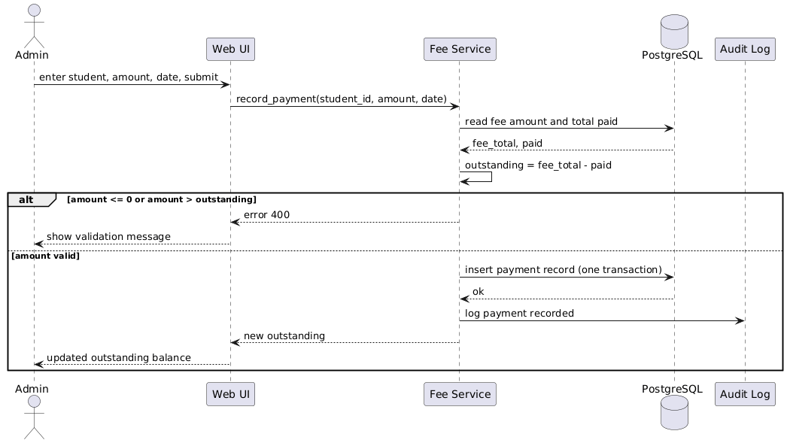
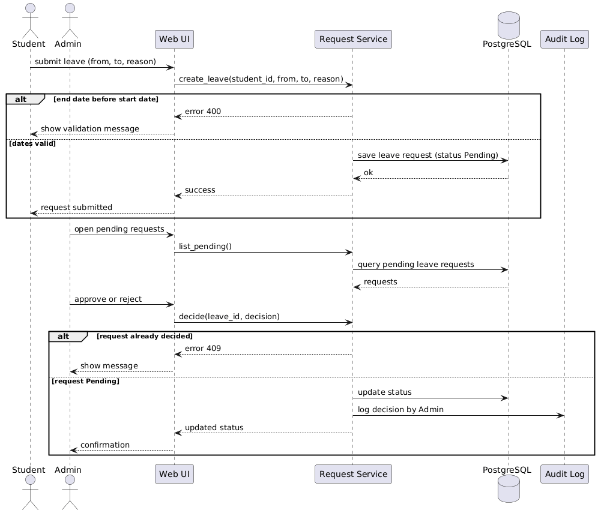

# Software Architecture and Design Specification

- **Project:** Hostel Management System (HMS)
- **Version:** 1.0
- **Authors:** Group G-03 - Tejasvi K S (PES1UG24CS499), Prathiksha B P (PES1UG24CS925), Vilohith (PES1UG24CS535), Varsha (PES1UG24CS516)
- **Date:** 12-10-2026
- **Status:** Draft for review

# Revision History

| Version | Date | Author | Change Summary |
|---|---|---|---|
| 0.1 | 11-10-2026 | Team | Initial draft of architecture and design |
| 1.0 | 12-10-2026 | Team | Reviewed and submitted for Jackfruit Part 1 |

# Approvals

| Role | Name | Signature/Date |
|---|---|---|
| Team Lead | | |
| Faculty | | |

# 1. Introduction

## 1.1 Purpose

This document specifies the architecture and design of the Hostel Management System (HMS), a web application that manages hostel room allocation, student details, fee payment records, complaints and leave requests.

## 1.2 Scope

Covers four functional modules: Accounts & Access, Room Allocation, Fee & Payment, and Complaints & Leave. Mobile apps, online payment gateways and visitor management are out of scope (SRS 1.3).

## 1.3 Audience

Developers, QA engineers, security reviewers, faculty evaluators and future maintainers.

## 1.4 Definitions

HMS (Hostel Management System), SRS (Software Requirements Specification), STP (Software Test Plan), RBAC (Role-Based Access Control), MVT (Model-View-Template, Django's architecture style), ORM (Object-Relational Mapper), CSRF (Cross-Site Request Forgery), STRIDE (Spoofing, Tampering, Repudiation, Information disclosure, Denial of service, Elevation of privilege), UML (Unified Modeling Language), NFR (Non-Functional Requirement).

# 2. Document Overview

## 2.1 How to use this document

Section 3 describes the architecture: components, pattern, technology and security. Section 4 describes the design: sequence diagrams, APIs, error handling and UX.

## 2.2 Related Documents

SRS v1.3 (requirements and traceability matrix), STP v1.0 (test plan and test cases).

# 3. Architecture


```
## 3.1 Goals & Constraints

**Goals**
- Security: protect student personal and fee data
- Correctness: no double allocation and no mismatch between fees, payments and outstanding balance
- Maintainability: one Django app per module, business rules in service functions
- Usability: common tasks completed in a few screens (NFR-2)
- Responsiveness: meet the response-time requirement (NFR-1)

**Constraints**
- Python with Django and PostgreSQL, as committed in the SRS
- Server-rendered web pages, no separate mobile app or REST API
- Four-person team and a fixed academic deadline
- Open-source tooling: Git/GitHub, Jenkins, Docker, SonarQube, pytest
- All code, including LLM-assisted code, must be understood and explainable by its author
```


## 3.2 Stakeholders & Concerns

| Stakeholder | Concerns |
|---|---|
| Student | Easy view of room and fees, privacy of personal data, quick complaint and leave handling |
| Admin | Control over students, rooms, fees and requests; accurate records; dues report |
| Developers / maintainers | Modularity, readable code, testability |
| Faculty / evaluators | Traceability, security, evidence of process |

## 3.3 Component (UML) Diagram


*Figure 1: HMS component diagram. Arrows show the direction of dependency.*

## 3.4 Component Descriptions

- **C1 Web UI (Templates):** server-rendered Django pages for Student and Admin; collects input and shows results.
- **C2 Accounts & Access:** registration with admin verification, login, sessions, roles and student profiles; used by every other component for authentication and authorisation.
- **C3 Room Allocation:** blocks, rooms with capacity, allocation, deallocation and occupancy status; asks C2 whether a student is Verified before allocating.
- **C4 Fee & Payment:** fee amount per student, payment records, outstanding balance and the dues report.
- **C5 Complaints & Leave:** complaint filing and status tracking, leave requests and Admin decisions; links records to the student (C2) and room (C3).
- **C6 PostgreSQL database:** stores users, rooms, fees, payments, complaints and leave requests with foreign-key constraints.
- **C7 Logging & Audit:** records failed logins, denied access and key business actions (allocation, payment, decisions) as required by SEC-6.

## 3.5 Chosen Architecture Pattern and Rationale

HMS uses a **layered modular monolith** built on Django's Model-View-Template style. Layers: Presentation (templates) -> Views (request handling and validation) -> Services (business rules) -> Models/ORM -> PostgreSQL. Each functional module is one Django app with its own models, views, services and tests, so team members work in separate folders and modules call each other only through service functions.

**Rejected alternatives:** microservices, because they add deployment and network complexity and make transactions such as allocation with an occupancy update harder, which is not justified for a four-person team and a single relational database; a flat single-app monolith, because it gives poor separation of concerns and constant merge conflicts.


```
## 3.6 Technology Stack & Data Stores

| Area | Technology |
|---|---|
| Language | Python 3 |
| Framework | Django (Model-View-Template) |
| Database | PostgreSQL |
| Front end | Django templates, HTML, CSS |
| Testing | pytest, Django test client, coverage.py |
| CI/CD | Jenkins |
| Containers | Docker |
| Static analysis | SonarQube |
| Version control and planning | Git, GitHub, GitHub Projects or Jira |

**Main data stores (PostgreSQL tables):** Student/User with role and optional room (C2); Block and Room (C3); Fee and PaymentRecord (C4); Complaint and LeaveRequest (C5). Field layouts are in SRS Appendix B.

**Why PostgreSQL:** ACID transactions for allocation and payment updates, foreign keys and constraints for data integrity, row-level locking for concurrent allocation requests, and first-class Django support.

## 3.7 Risks & Mitigations

| Risk | Mitigation |
|---|---|
| Double allocation of a room under concurrent requests | Database transaction with row locking and a capacity check |
| Merge conflicts in shared models (Student, Room) | Agree shared models first, small pull requests, CI on every PR |
| Missed role check exposes an admin page | RBAC applied on every view, authorisation tests, SonarQube scan |
| Fees, payments and outstanding balance become inconsistent | Compute the balance from fee and payments inside one transaction, unit tests |
| Sensitive data leaks into logs | Logging policy and code review |
| Schedule slip | Weekly Scrum review, scope fixed to four modules |
```

```
## 3.8 Traceability to Requirements

| Requirement | Description | Component | Design reference |
|---|---|---|---|
| REQ-1 | Register with unique email and SRN | C2 Accounts & Access | 3.4, 4.3.1 |
| REQ-2 | New accounts stay Pending until verified | C2 | 3.4, 4.3.1 |
| REQ-3 | Admin approves or rejects a registration | C2 | 3.4, 4.3.1 |
| REQ-4 | Role-based access | C2 (all views) | 3.9, 4.2.1 |
| REQ-5 | Student views and edits own profile | C2 | 3.4 |
| REQ-6 | Define blocks and rooms with capacity | C3 Room Allocation | 3.4, 4.3.2 |
| REQ-7 | Prevent allocation beyond capacity | C3 | 4.2.2, 4.3.2 |
| REQ-8 | Allocate a room to a Verified student | C3 | 4.2.2, 4.3.2 |
| REQ-9 | Deallocate a student from a room | C3 | 4.3.2 |
| REQ-10 | Automatic occupancy and status update | C3 | 4.2.2 |
| REQ-11 | Admin defines a fee amount for a student | C4 Fee & Payment | 3.4, 4.3.3 |
| REQ-12 | Admin records a payment | C4 | 4.2.3, 4.3.3 |
| REQ-13 | Outstanding balance calculation | C4 | 4.2.3, 4.3.3 |
| REQ-14 | Payment cannot exceed outstanding balance | C4 | 4.2.3, 4.3.3 |
| REQ-15 | Student views own fee details | C4 | 4.3.3 |
| REQ-16 | Admin dues report | C4 | 3.4 |
| REQ-17 | Student files a complaint | C5 Complaints & Leave | 3.4, 4.3.4 |
| REQ-18 | Admin updates complaint status | C5 | 4.3.4 |
| REQ-19 | Student submits a leave request | C5 | 4.2.4, 4.3.4 |
| REQ-20 | Admin approves or rejects a leave request | C5 | 4.2.4, 4.3.4 |
| REQ-21 | Login | C2 | 4.2.1, 4.3.1 |
| SEC-1 | Passwords stored hashed | C2 | 3.9 |
| SEC-2 | Role-based access for admin pages | C2 | 3.9 |
| SEC-3 | Input validation and sanitising | All components | 3.9, 4.4 |
| SEC-4 | Session expiry and rejection | C2 | 3.9, 4.2.1 |
| SEC-5 | CSRF protection | C1 Web UI | 3.9 |
| SEC-6 | Audit log | C7 Logging & Audit | 3.9, 4.4 |
| NFR-1 | Response time | C1 to C6 | 3.6 |
| NFR-2 | Complaint filed in 4 screens | C1 Web UI | 4.5 |
| NFR-3 | Atomic updates | C3, C4, C5 | 3.7, 4.2.2, 4.2.3 |
| NFR-4 | Modular code and 70% coverage | All components | 3.5, 4.1 |
| NFR-5 | Chrome and Firefox compatibility | C1 Web UI | 3.6 |
```

## 3.9 Security Architecture

**Security objectives (SRS 6.3.1):** SO-1 confidentiality of student, fee, complaint and leave data; SO-2 integrity of allocation and payment records; SO-3 accountability for privileged actions.

**Threat modelling (STRIDE)**

| Threat | Example in HMS | Mitigation |
|---|---|---|
| Spoofing | Someone logs in as another student | Django authentication, hashed passwords (SEC-1), server-side sessions |
| Tampering | Student edits another student's fee record or alters form fields | CSRF tokens (SEC-5), ORM parameterised queries, server-side validation and ownership checks (SEC-3) |
| Repudiation | Admin denies approving a leave request or allocation | Audit log with user and timestamp (SEC-6) |
| Information disclosure | Student views another student's profile or dues | Role-based views and object-level checks (SEC-2), HTTPS/TLS, no personal data or passwords in logs |
| Denial of service | Heavy report queries | Pagination, request timeouts, database indexes |
| Elevation of privilege | Student opens an admin URL | Role checked on the server in every view (RBAC, SEC-2), least-privilege database user |

- **Authentication:** every user logs in with email (or SRN for students) and a password. Passwords are never stored in plaintext (SEC-1). Accounts that are not Verified cannot log in (REQ-2, REQ-21).
- **Authorisation:** two roles (Student, Admin). Each view declares the roles allowed; any other role gets 403 (SEC-2).
- **Session management:** server-side sessions with an expiry time. Expired or invalid sessions are rejected and the user is sent to the login page (SEC-4).
- **Data protection:** the database is reachable only from the application container, and secrets are kept in environment variables, not in the repository.

# 4. Design


```
## 4.1 Design Overview

HMS is designed as layered modules for separation of concerns and easier maintenance. Each module is a Django app with the same structure: models (data), services (business rules), views (request handling and validation), URLs, templates and tests. Modules call each other only through service functions, for example the Room module asks the Accounts module whether a student is Verified before allocating a room.

**Key classes (see SRS Appendix B for fields):** Student/User (role, registration status, SRN, optional room), Block, Room (block, room type, capacity, status), Fee (student, amount), PaymentRecord (student, amount, date), Complaint (student, room, description, status), LeaveRequest (student, dates, reason, status).
```

## 4.2 UML Sequence Diagrams

### 4.2.1 Login and Role Check

The sequence diagram below illustrates authentication, account verification, session creation, role checking, and audit logging.


### 4.2.2 Allocate a room (Room Allocation)
Shows the Admin allocating a room (REQ-7, REQ-8, REQ-10). The service rejects a student who is not Verified or already has a room, and a room that is full. The allocation and the occupancy change are saved in one database transaction (NFR-3) and the action is written to the audit log (SEC-6).


```
### 4.2.3 Record a payment (Fee & Payment)
Shows the Admin recording a payment (REQ-12, REQ-13, REQ-14). The service calculates the outstanding balance and rejects an amount that is zero, negative or larger than the outstanding balance. A valid payment is saved in one transaction and written to the audit log.


```

```
### 4.2.4 Leave request and Admin approval (Complaints & Leave)
Shows a student submitting a leave request (REQ-19) and the Admin approving or rejecting it (REQ-20). A decision is accepted only while the request is still Pending, and is written to the audit log.


```


## 4.3 API Design

Interfaces below are Django URL routes that receive HTML form submissions (GET and POST). Request and response fields describe the form inputs and the page results. There is no separate REST API (SRS 3.3).

### 4.3.1 Accounts & Access API

**POST /accounts/register/** (REQ-1, REQ-2)
- Auth: none
- Request: {name, email, srn, guardian_contact, password}
- Response: {status, user_id} (account created as Pending)
- Errors: 400 missing or invalid field, 409 email or SRN already registered

**POST /accounts/login/** (REQ-21)
- Auth: none
- Request: {identifier (email or SRN), password}
- Response: {status, role, redirect}
- Errors: 401 invalid credentials or account not Verified

**POST /accounts/registrations/{id}/decision/** (REQ-3)
- Auth: Admin
- Request: {decision (Verified or Rejected)}
- Response: {user_id, registration_status}
- Errors: 400 invalid decision, 403 role not permitted, 404 registration not found

### 4.3.2 Room Allocation API

**GET /rooms/available/**
- Auth: logged-in user (Student or Admin)
- Request: query parameters block, room_type
- Response: list of {room_id, block, room_type, capacity, occupied}
- Errors: 400 invalid filter, 401 not logged in

**POST /rooms/allocate/** (REQ-7, REQ-8, REQ-10)
- Auth: Admin
- Request: {student_id, room_id}
- Response: {status, room_id, occupied}
- Errors: 400 invalid input, 403 role not permitted, 404 student or room not found, 409 room full, student not Verified, or student already allocated

**POST /rooms/deallocate/** (REQ-9, REQ-10)
- Auth: Admin
- Request: {student_id}
- Response: {status, room_id, occupied}
- Errors: 400 invalid input, 403 role not permitted, 404 student not found or has no room

```
### 4.3.3 Fee & Payment API

**POST /payments/fee/** (REQ-11)
- Auth: Admin
- Request: {student_id, amount}
- Response: {status, fee_id}
- Errors: 400 amount not greater than 0, 403 role not permitted, 404 student not found

**POST /payments/record/** (REQ-12, REQ-14)
- Auth: Admin
- Request: {student_id, amount, payment_date}
- Response: {status, payment_id, outstanding}
- Errors: 400 amount not greater than 0, amount exceeds outstanding, or invalid date; 403 role not permitted; 404 student not found

**GET /payments/dues/{student_id}/** (REQ-13, REQ-15)
- Auth: the student themselves, or Admin
- Request: student_id in the path
- Response: {fee_total, paid, outstanding, payments}
- Errors: 401 not logged in or session expired, 403 viewing another student's dues, 404 student not found
```
```
### 4.3.4 Complaints & Leave API

**POST /complaints/** (REQ-17)
- Auth: Student
- Request: {description} (the room is taken from the student's allocated room)
- Response: {complaint_id, status}
- Errors: 400 missing or invalid field, 401 not logged in, 403 student has no allocated room

**POST /complaints/{id}/status/** (REQ-18)
- Auth: Admin
- Request: {status (In-progress or Resolved)}
- Response: {complaint_id, status}
- Errors: 400 invalid status, 403 role not permitted, 404 complaint not found

**POST /leaves/** (REQ-19)
- Auth: Student
- Request: {start_date, end_date, reason}
- Response: {leave_id, status}
- Errors: 400 end date before start date or missing field, 401 not logged in

**POST /leaves/{id}/decision/** (REQ-20)
- Auth: Admin
- Request: {decision (Approved or Rejected)}
- Response: {leave_id, status}
- Errors: 400 invalid decision, 403 role not permitted, 404 leave request not found, 409 request already decided
```

```
## 4.4 Error Handling, Logging & Monitoring

**Error handling:** every view validates input on the server and returns a consistent error. Pages show a short, friendly message. Unexpected errors show a generic message to the user and full details only in the server log.

| Code | Meaning | Example in HMS |
|---|---|---|
| 400 | Validation failure | Payment amount is zero or above the outstanding balance, leave end date before start date |
| 401 | Not logged in or session expired | Opening dues after the session expired |
| 403 | Role or ownership not allowed | Student opens the allocation page |
| 404 | Record not found | Unknown student or room id |
| 409 | Business-rule conflict | Room full, student already allocated, leave already decided |
| 500 | Unexpected error | Generic message to user, details in log |

**Logging (SEC-6):** failed logins, permission denials, allocations, payments and decisions are logged with user id and timestamp. Passwords, session tokens and full personal details are never logged.

**Monitoring:** track error rate, failed-login count, response time of key pages, and the CI test and SonarQube results on every build.
```


```
## 4.5 UX Design

Role-based dashboards for Student and Admin, simple forms with clear validation messages, consistent navigation and readable font sizes. Filing a complaint takes no more than four screens (NFR-2). Screen prototypes are in SRS section 3.1.

## 4.6 Open Issues & Next Steps

- Email or SMS notifications for approvals and dues
- Online payment gateway integration
- Report export to CSV or PDF
- Database indexes tuned after performance testing
- Mobile app

# 5. Appendices

**5.1 Glossary:** HMS, RBAC, MVT, ORM, CSRF, STRIDE, UML, SRS, STP, NFR.
**5.2 References:** IEEE 42010, OWASP Top 10, Django documentation, HMS SRS v1.3, HMS STP v1.0.
**5.3 Tools:** PlantUML, draw.io, Postman, GitHub, Jenkins, SonarQube.
```
